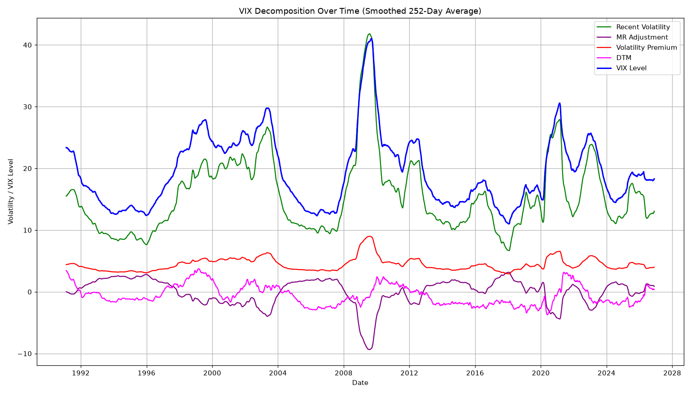
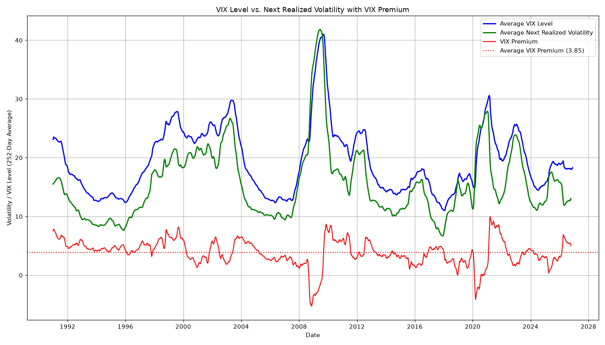
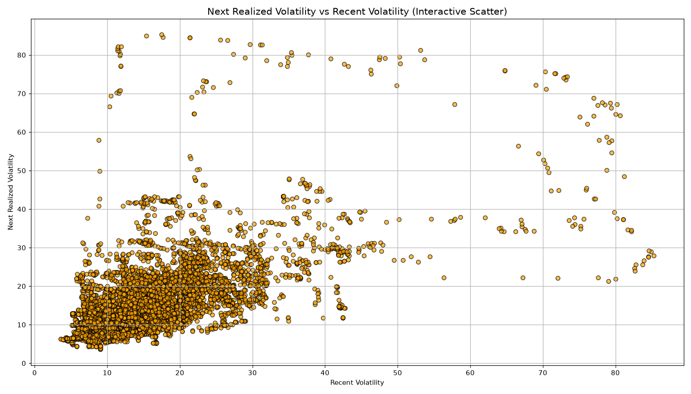
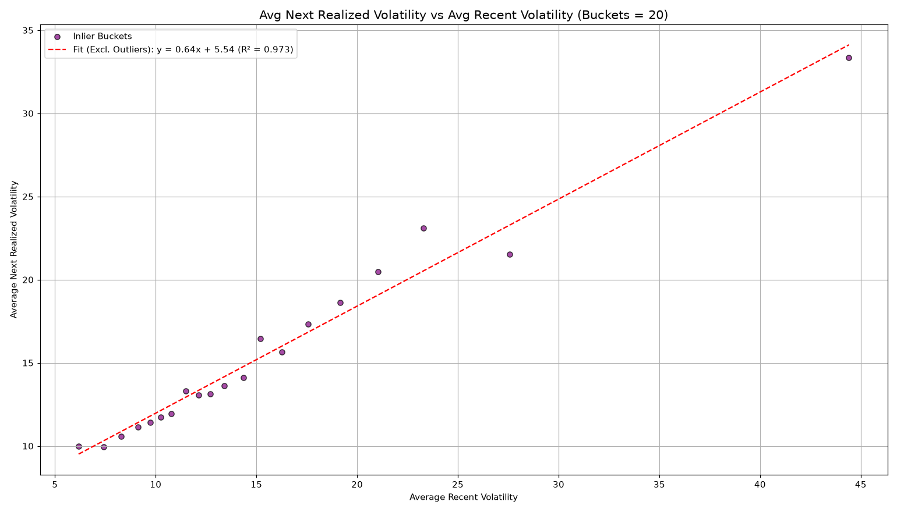
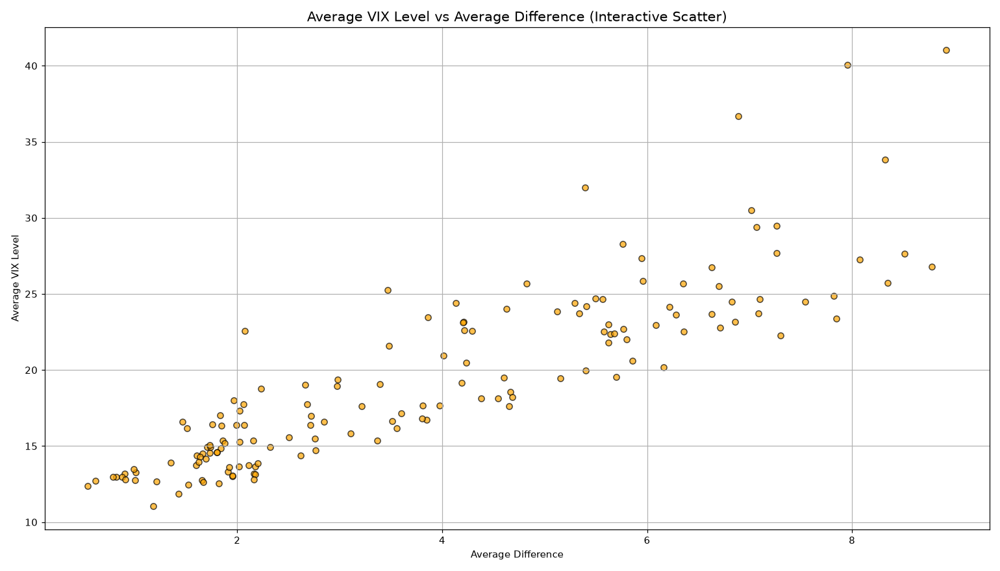
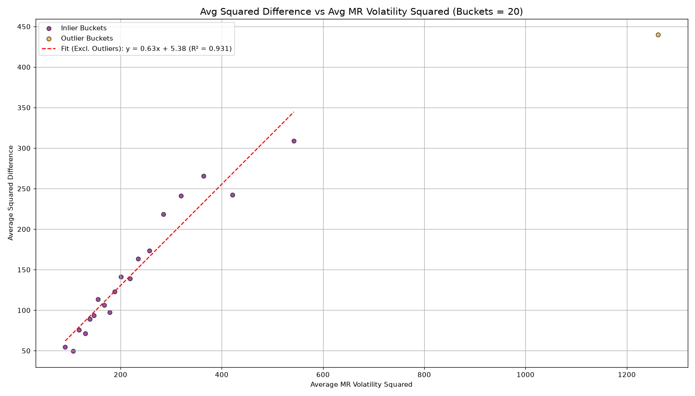
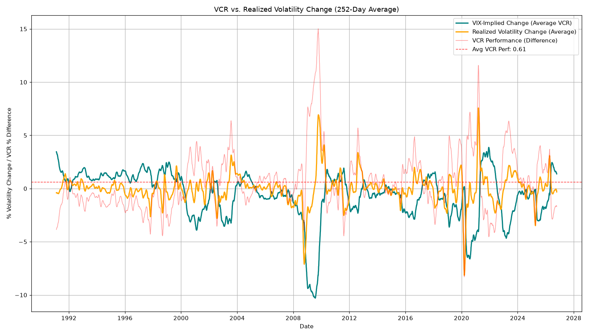
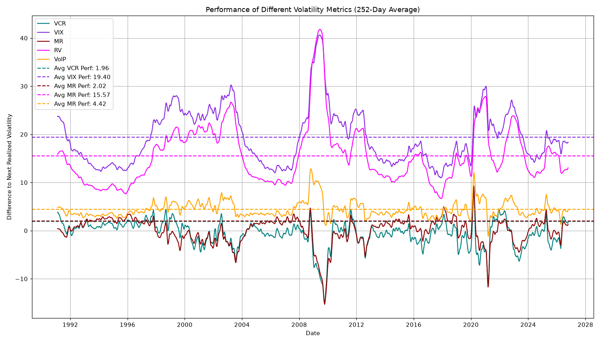

# Reading VIX: Findings from the VCR Program

This write-up uses the output of `main.py`, which computes the decomposition and draws the graphs. `update_csvs.py` refreshes the data and regenerates every CSV and figure (see [Updating the data](#updating-the-data)).

Every daily VIX close is split into four additive parts, all measured in volatility points:

$$
\text{VIX} = \underbrace{\text{Recent Volatility}}_{\text{backward-looking}} + \underbrace{\text{MR Adjustment}}_{\text{historical norm}} + \underbrace{\text{Volatility Premium}}_{\text{historical norm}} + \underbrace{\text{DTM}}_{\text{market's view}}
$$

The VIX-Implied Change in Realized Volatility is then defined as

$$
\text{VCR} = \text{MR Adjustment} + \text{DTM}.
$$

It is the change in realized volatility over the next period that VIX implies once the usual premium is removed. The identity holds exactly: on every valid day, Recent Volatility + MR Adjustment + Volatility Premium + DTM equals the VIX level with zero error.



*Figure 1. Each component of the decomposition as a 252-trading-day trailing average. Blue (VIX) is the sum of the other four lines.*

**Data and setup.** The data are daily S&P 500 and VIX closes from 1990-01-03 to 2026-11-25 (9,292 days). Rows through 2025-09-04 come from Investing.com CSVs; later rows come from Yahoo Finance (`^GSPC`, `^VIX`) via yfinance, written in the same format. Every parameter is fit once on the full sample using 20 percentile buckets. The figures are the program's own charts, saved by `update_csvs.py` without any change to the plotting code.

**Fitted parameters**

| Parameter | Value | Meaning |
|---|---|---|
| S (speed) | 35.6% | Share of the gap to the mean that volatility closes in one 30-trading-day period |
| M (mean) | 15.5 | Long-run level that volatility reverts to |
| c, d | 0.63, 5.4 | Variance premium, VP = c·MRvol² + d |

**Component averages, 1990–2026**

| | Mean | Std. dev. | Max |
|---|---|---|---|
| VIX | 19.43 | 7.71 | 82.69 |
| Recent Volatility | 15.52 | 9.23 | 85.30 |
| MR Adjustment | 0.01 | 3.29 | 4.26 |
| Volatility Premium | 4.42 | 1.60 | 16.65 |
| DTM | −0.52 | 4.09 | 27.45 |
| VCR | −0.51 | 5.80 | 20.09 |

---

## 1. Recent Volatility

**What it is.** Recent volatility is the annualized standard deviation of S&P 500 daily returns over a trailing window. It is the only component that is purely backward-looking: it says how much the market has actually been moving. It is the starting point for reading VIX. Before asking whether VIX is "high", ask whether VIX is high *relative to what the market is already doing*.

**How the program computes it** (`EVIX.calc_recent_volatility`):

$$
\text{RV}_t = \text{std}\big(r_{t-29},\dots,r_t\big)\cdot\sqrt{252}
$$

Here $r$ is the daily `Change %` of the S&P 500. Next Realized Volatility is the same quantity computed over the following 30 trading days, $r_{t+1},\dots,r_{t+30}$.

**Findings**

- **Recent volatility carries most of VIX.** Over the full sample, VIX averaged 19.4 and recent volatility averaged 15.5. In Figure 1 the green and blue lines move almost in step: the spikes in 2008–09, 2020 and 2022 appear in both. On a typical day, the other three components together add only about 4 points.
- **VIX usually sits above the volatility that follows.** VIX was higher than the next period's realized volatility on 85% of days, by 3.9 points on average (Figure 2). The exceptions are sudden crises such as late 2008 and early 2020. Realized volatility then rose faster than VIX had priced, and the trailing premium briefly went negative (about −5 at the end of 2008).



*Figure 2. 252-day trailing averages of VIX (blue) and next realized volatility (green). Red is the gap between them, the "VIX premium". The dotted line is its mean of 3.85.*

- **Recent volatility alone is a weak forecast.** Figure 3 plots each day's recent volatility against the next period's realized volatility. The cloud is wide: a recent volatility near 20 has been followed by anything from about 5 to more than 50. One day's number tells you little, and that is why the next two components exist.

---

## 2. Mean Reversion (MR Adjustment)

**What it is.** Volatility tends to drift back toward a long-run average. When it is unusually high it tends to fall, and when it is unusually low it tends to rise. The MR Adjustment is the change in recent volatility you would expect from that pull alone, in volatility points.

**How it is estimated.** Days are sorted into 20 equal-sized buckets by recent volatility. A line is then fit through the bucket averages of recent volatility (x) and next realized volatility (y):

$$
y = a x + b \quad\Rightarrow\quad S = 1-a,\qquad M = \frac{b}{1-a}
$$

$$
\text{MR Volatility} = \text{RV} + S\,(M - \text{RV}), \qquad \text{MR Adjustment} = S\,(M - \text{RV})
$$



*Figure 3. Each point is one day: recent volatility (x) against the realized volatility over the following 30 trading days (y). The raw data are very noisy.*



*Figure 4. The same data averaged in 20 percentile buckets. The fit is y = 0.64x + 5.54 with R² = 0.973, which gives S = 35.6% and M = 15.5.*

**Findings**

- **The average relationship is almost perfectly linear.** Figure 3 is noisy, but averaging within buckets (Figure 4) leaves a nearly straight line with R² = 0.97. That linearity is what makes a single speed S and mean M meaningful.
- **Volatility reverts to about 15.5, closing about a third of the gap each period.** With S = 35.6%, half of any gap closes in about 1.6 periods, roughly two calendar months.
- **The sign of the adjustment follows the level of volatility.** Figure 1 shows MR Adjustment (purple) as the mirror image of recent volatility. It was positive through the calm years (1993–96, 2004–07, 2013–19), peaking in 2017 when recent volatility hit record lows and the adjustment averaged +3.1. It was deeply negative in crises: −6.6 on average in 2008, and as low as −23 in November 2008. In a calm market, mean reversion says volatility should rise. In a panic, it says volatility should fall.
- **The fit is weakest at high volatility.** In Figure 4, the bucket at recent volatility of about 28 lies below the line. The very top bucket, about 44, sits near the line only because it is so far out on the x-axis. The top 5% of days (recent volatility above 30.5) behave differently from the rest.
- **Mean reversion on its own is a modest forecast.** As a prediction of the next change in volatility, MR Adjustment has a correlation of 0.44 with what actually happened. On days with recent volatility ≤ 30, its median absolute error is 2.97 points, against 2.76 for simply assuming no change. Its mean error is lower than the no-change forecast (4.07 vs 4.20). These statistics were computed for this write-up and are not output by `main.py`. The full comparison is in Section 4.

---

## 3. Volatility Premium

**What it is.** Options buyers pay for protection, so VIX normally prices *more* volatility than is expected even after mean reversion. The Volatility Premium is that extra amount, in volatility points.

**How it is estimated.** This is a two-step process.

1. **Find the right variable.** Figure 5 plots 252-day averages, sampled every 60 days. The gap between VIX and MR volatility rises with the VIX level (R² = 0.76). So the premium is tied to MR volatility.



*Figure 5. 252-day averages, sampled every 60 days: the average gap between VIX and MR volatility (x) against the average VIX level (y). R² = 0.76.*

2. **Fit it in variance (squared) terms.** The program buckets days by MR volatility², averages the squared difference VIX² − MRvol² in each bucket, and fits a line. The top 5% bucket is excluded as an outlier.

$$
\text{VP} = c\cdot\text{MRvol}^2 + d,\qquad \text{EVIX} = \sqrt{\text{MRvol}^2 + \text{VP}},\qquad \text{Volatility Premium} = \text{EVIX} - \text{MRvol}
$$



*Figure 6. Bucket averages of MR volatility² (x) against VIX² − MR volatility² (y). The fit excludes bucket 20 (orange): y = 0.63x + 5.38, R² = 0.931.*

**Findings**

- **The squared fit is better than the unsquared one.** Fitting the same 19 buckets in plain volatility terms (VIX − MRvol against MRvol) gives R² = 0.83. In squared terms it is 0.93. The premium is better described as linear in variance than in volatility.
- **The top bucket is clearly different.** Bucket 20 (average MRvol² ≈ 1,260, i.e. MR volatility around 35.5) sits far below the line in Figure 6. Including it drops R² to 0.84 and changes the fit to c = 0.35, d = 63. In the worst crises the premium does not keep growing in proportion to variance.
- **The premium is always positive and fairly stable.** The Volatility Premium was positive on 100% of days. It averaged 4.4 points, with a minimum of 2.4 and a maximum of 16.7. In Figure 1 the red line is the flattest of the four components. It sits around 3–4 in calm years and widens in stressed years (7.6 in 2008, 6.4 in 2009, 6.5 in 2020, 5.8 in 2022), because the premium scales with variance.
- **Together, the first three components give the "expected" VIX.** Recent volatility, MR Adjustment and Volatility Premium sum to EVIX, the level VIX *should* be at given historical norms. EVIX averaged 19.9 against an actual VIX average of 19.4.

**Bug in the program's check.** `EVIX.check()` adds up `RV + MR Adjustment + Variance Premium + DTM`. The Variance Premium is in squared (variance) units, so CHECK overshoots VIX by about 174 points on average. With the *Volatility* Premium in its place, the sum equals VIX exactly. Only the check is affected. No other output uses it.

---

## 4. Difference to Model (DTM)

**What it is.** DTM is what is left over: how far the actual VIX sits from EVIX, the level history says it should be at.

$$
\text{DTM} = \text{VIX} - \text{EVIX}
$$

Recent volatility is purely observed, and the MR Adjustment and Volatility Premium come from long-run historical fits. DTM is the only part that reflects the market's current expectations. A positive DTM means VIX is higher than historical norms justify, so the market expects trouble or is paying up for protection. A negative DTM means VIX is lower than norms justify, so the market is calm.

**Findings**

- **DTM is usually slightly negative.** It averaged −0.52 and was positive on only 40% of days. In Figure 1 the magenta line sits below zero for long calm stretches: 2005–07 (about −2.5), 2013–19 (−1.7 to −2.7) and 2023–25 (−1.4 to −1.6). It turns positive in the run-up to and aftermath of stress: 1990, 1997–99, 2009–10, 2021 and 2026 (+0.6 so far).
- **2017 was low but not anomalous.** In 2017 VIX averaged 11.1, while EVIX was 12.8, so DTM averaged −1.7. Recent volatility was so low (6.7) that VIX was still well *above* it. The low reading was mostly a calm market, with only a modest discount added on top.
- **DTM spikes when the market expects more than history.** Three dates illustrate this, with the latest day in the data for comparison:

| Date | VIX | Recent Vol | MR Adj | Vol Premium | DTM | VCR |
|---|---|---|---|---|---|---|
| 2008-11-20 | 80.9 | 78.8 | −22.6 | 15.5 | +9.1 | −13.5 |
| 2020-03-16 | 82.7 | 66.6 | −18.2 | 13.4 | +20.9 | +2.7 |
| 2025-04-08 | 52.3 | 28.4 | −4.6 | 6.6 | +21.9 | +17.3 |
| 2026-11-20 | 35.9 | 22.2 | −2.4 | 5.6 | +10.5 | +8.1 |
| 2026-11-25 (last) | 28.3 | 26.6 | −3.9 | 6.3 | −0.7 | −4.6 |

  In November 2008, recent volatility was already extreme. Mean reversion said it should fall a lot (−22.6), and a positive DTM only partly offset that, so the VCR still predicted a fall. In March 2020 and April 2025 VIX jumped faster than realized volatility had. The large positive DTM overrode mean reversion, and the VCR said volatility would *rise*. These are extreme days in the top-5% regime, where the fits are least reliable. November 2026 shows the same pattern on a smaller scale: on 2026-11-20 VIX jumped to 35.9 ahead of realized volatility (DTM +10.5). Three trading days later recent volatility had caught up to 26.6, DTM was back near zero, and mean reversion drove the VCR negative.

### DTM and the VCR

DTM matters most as one half of the VCR. DTM measures how high or low VIX is relative to a value that *already includes* mean reversion. To test whether DTM predicts anything, add it back to the MR Adjustment and compare the sum, the VCR, with the change in volatility that actually followed.



*Figure 7. The program's VCR performance chart (252-day averages). **Caution:** the orange "Realized Volatility Change" line is computed as Recent − Next, which is the opposite sign of what the VCR predicts (Next − Recent). Flip the orange line vertically before comparing it to the teal line. For example, in 2009 the VCR (−10) and the actual fall in volatility agree, even though the chart makes them look opposed. The "Avg VCR Perf: 0.61" label inherits the same sign error and is not meaningful.*

**Predictive record (computed for this write-up with the correct sign, Next − Recent).** The VCR has a correlation of 0.56 with the realized change. That is higher than either of its parts alone (MR Adjustment 0.44, DTM 0.44), so DTM adds information that mean reversion does not already have. The VCR's sign matched the direction of the actual change on 71% of days.

The table below compares the VCR against three simpler ways of predicting the next change in recent volatility:

- "Recent Vol" assumes no change.
- "MR Vol" predicts the MR Adjustment.
- "VIX" treats VIX as the forecast of next volatility, so it predicts VIX − RV.

Errors are absolute, in volatility points, over 1990–2026 on days with recent volatility ≤ 30 (the last scored day is 2026-10-14, because each score needs the following 30 trading days):

| Absolute error | VCR | Recent Vol | MR Vol | VIX |
|---|---|---|---|---|
| Median | **2.38** | 2.76 | 2.97 | 4.89 |
| Mean | **3.74** | 4.20 | 4.07 | 5.65 |
| 25th percentile | **1.12** | 1.33 | 1.44 | 2.88 |
| 75th percentile | **4.61** | 5.21 | 5.00 | 7.35 |

- **The VCR has the lowest error on every measure.** Using VIX as a direct forecast is the worst, because it carries the volatility premium.
- **No predictor is accurate.** A median miss of about 2.4 volatility points is large next to a typical VIX of 15–20.
- **These results are in-sample.** S, M, c and d were fit on the same data they are scored on, so the VCR's real-time accuracy would be somewhat worse.

**Note on the program's comparison chart.** `Grapher.all_performance` (Figure 8) plots VIX and recent volatility *levels* against a volatility *change*. It also uses the sign-flipped target, and its legend labels three different lines "Avg MR Perf". Its averages (for example "Avg VIX Perf: 19.40") therefore do not measure forecast skill. The table above replaces it.



*Figure 8. The program's all-metric comparison chart (252-day averages), included for completeness. For the reasons above, read the error table instead.*

---

## Updating the data

`update_csvs.py` brings every CSV and figure up to date in one step:

```bash
python update_csvs.py              # fetch new days, rerun main.py, save figures/
python update_csvs.py --dry-run    # only report which days would be fetched
python update_csvs.py --no-fetch   # rerun the pipeline on the CSVs as they are
python update_csvs.py --through 2026-11-25
```

1. **Fetch.** New trading days after the newest row of `SPX.csv` and `VIX.csv` are pulled from Yahoo Finance and added to the top of each file in the Investing.com format. Existing rows are never rewritten. Before anything is written, the newest existing closes are re-fetched and compared, and a mismatch above 1% stops the update. By default the fetch stops at the last completed US session, so a partial intraday bar is never saved.
2. **Rebuild.** `main.main()` runs unchanged with a non-interactive plotting backend. It rewrites `OUT.csv` and `mrperf.csv`, `vixperf.csv` and `vcrperf.csv` (the series that `Grapher.all_performance` used to save), and saves Figures 1–8 to `figures/`.

The numbers in this README were computed from the updated data. They do not update themselves when the script runs.


- Bennett, C. (2014). *Trading volatility: Trading volatility, correlation, term structure and skew*. CreateSpace Independent Publishing Platform. 
- Edwards, T., & Preston, H. (2017). *Reading VIX®: Does VIX predict future volatility?* S&P Dow Jones Indices. 


